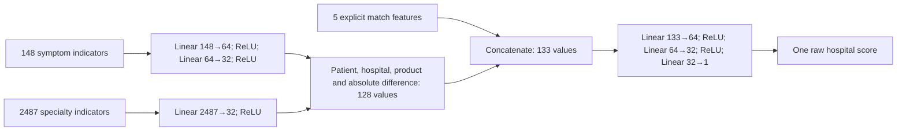
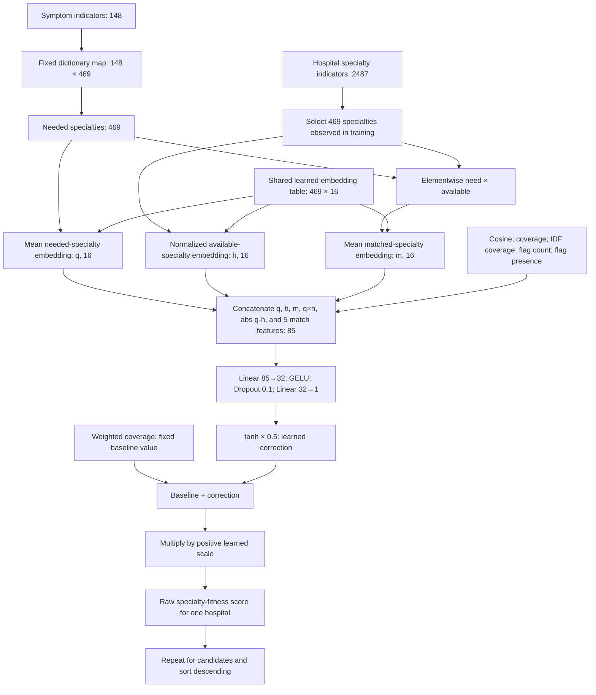
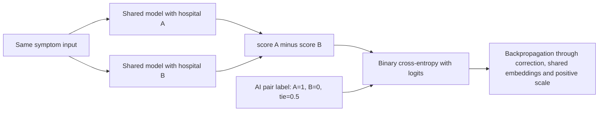

# Specialty model architecture and refinement

The refined model learns a correction to weighted coverage using the supplied
symptom-to-specialty map and shared specialty embeddings. It has 10,290 trainable
parameters. This is a specialty-matching component, not a clinical triage model.

## Why the first model added little over coverage

The original model had 101,921 parameters and scored a patient–hospital pair:



Evidence from this dataset and saved checkpoint:

- All 21 validation symptom IDs were absent from training. Their individual input
  weights did not receive symptom-specific supervised learning signals. Eleven of
  those scenarios nevertheless have dictionary need profiles already seen in training.
- Only 469 of the 2,487 specialty columns were observed among training candidates.
  Most of the original hospital projection's input weights thus had no supervised
  exposure; unseen specialty inputs could activate untrained weights.
- The five explicit match features already contain weighted coverage. Most teacher
  labels reward closely related specialty-matching information, so this baseline is strong.
- There is exactly one symptom per example. No architecture can demonstrate learned
  multi-symptom interactions from this dataset.
- In a frozen-input diagnostic, original validation agreement fell from 95.3% to 80.3%
  when explicit match features were zeroed. Zeroing symptom IDs gave 93.7%. These are
  out-of-distribution sensitivity checks, not causal attribution estimates.
- A controlled replay of seed 42 reproduced the user's epoch-10 training loss exactly.
  Its minimum validation loss occurred at epoch 3, while training loss kept declining.

## Complete refined model



All three embedding pools use the same table. The patient branch maps symptoms to
their supplied specialty needs, rather than learning an independent representation
for every symptom ID. An unseen symptom can therefore reuse a familiar need profile.
The shared representation is based on the editorial dictionary; it is not a pretrained
language model, independently verified clinical knowledge, or extra text supervision.

The available-specialty pool divides its embedding sum by the square root of the
number of active listings. Needed and matched pools use the ordinary mean. Empty
pools produce zero vectors. Hospital specialties unseen in training do not receive
random learned contributions; the deterministic match features remain available.

The final equation is:

`score(patient, hospital) = softplus(scale_parameter) × [IDF_coverage + 0.5 × tanh(MLP(joint_features))]`

The correction's last layer starts at zero, so the initial model is a positive-scaled
weighted-coverage baseline. Training learns departures from that baseline. The
correction is bounded; the resulting score is not a calibrated probability or a 0–40
score. Prediction exposes baseline, correction and scale as an exact score decomposition.
This decomposition does not identify a clinical reason for every learned adjustment.

## Training flow



The loss, learning rate, optimizer, tie weight and training splits were held fixed
across the comparison. Each model used seeds 42,43,44; up to 25 epochs, minimum 10,
patience 4 and minimum validation-loss improvement 0.0001. The best checkpoint by
validation logistic loss was retained. Test labels were not evaluated.

This remains direct pairwise logistic training. NDCG-weighted LambdaLoss needs graded
relevance targets; no grades were manufactured from these direct preferences.

## Results

All figures below use the same 127 strict validation comparisons across 20 scenarios.
Predicted exact ties get half credit; the 121 teacher-tied validation pairs are included
in validation loss but excluded from strict preference agreement.

| Method | Parameters | Mean agreement over 3 seeds | Mean validation loss |
|---|---:|---:|---:|
| Fixed IDF coverage | 0 | 94.9% | Not compared: score scale is not fitted |
| Original MLP, best epoch by validation loss | 101,921 | 94.8% | 0.3257 |
| Five-match-feature MLP control | 113 | 93.3% | 0.3383 |
| Refined shared-specialty correction model | 10,290 | 99.0% | 0.2845 |

The refined runs achieved 99.2%, 99.2% and 98.4%; best epochs were 4,6,3.
The original runs' best epochs were 3,2,3. The user's original final epoch-10 checkpoint
still achieved 95.3% strict agreement, with validation loss 0.3837.

The checkpoint selected by lowest validation loss across the predefined runs is
`runs/architecture_refinement/semantic_residual_seed_44/model.pt` (epoch 3), with
125/127 correct strict preferences (98.4%) and validation loss 0.2818. Selection was
by loss rather than maximum strict agreement, so seed 42/43 were not chosen merely
for their higher agreement. All original files/checkpoints are preserved.

These are promising development results. Validation was reused to select architectures,
epochs and a seed; these figures are not an independent final estimate. Pair labels
are provisional AI judgments and facility claims remain unverified. Tie handling
still has room to improve. Multi-symptom interactions remain untested.

## Run and inspect

From the project directory with the existing environment:

```bash
.venv/bin/python -m ranker.predict \
  --data data/pairwise_v2/prepared \
  --checkpoint runs/architecture_refinement/semantic_residual_seed_44/model.pt \
  --scenario scenario_002 --out runs/refined_prediction.json
```

To reproduce the bounded comparison into a new empty folder:

```bash
.venv/bin/python -m ranker.refine_architecture \
  --original-checkpoint runs/direct_pairs/model.pt \
  --out runs/architecture_refinement_repeat
```

`runs/architecture_refinement/comparison.json` contains all nine run summaries and
input-removal diagnostics. Each run has a checkpoint and per-epoch validation history.
`semantic_residual_seed_44/evaluation/` contains detailed held-out predictions.

Related background: [Revisiting Deep Learning Models for Tabular Data](https://arxiv.org/abs/2106.11959)
examines strong MLP-style baselines and finds no universally superior model family.
The correction architecture here is a project-specific design, not a reproduction of that paper.
